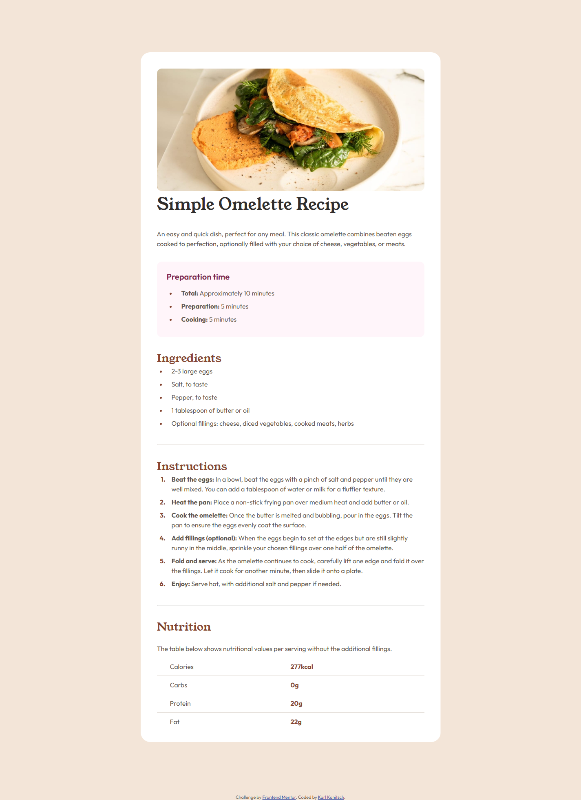
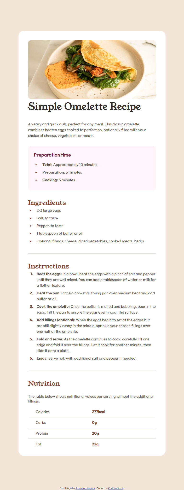
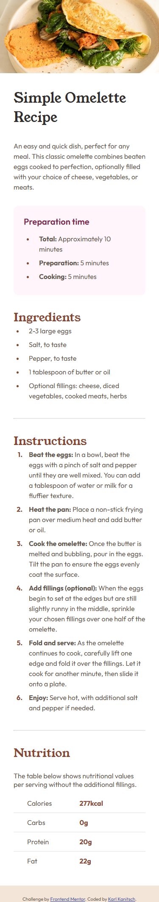

# Frontend Mentor - Recipe page solution

This is a solution to the [Recipe page challenge on Frontend Mentor](https://www.frontendmentor.io/challenges/recipe-page-KiTsR8QQKm). Frontend Mentor challenges help you improve your coding skills by building realistic projects. 

## Table of contents

- [Frontend Mentor - Recipe page solution](#frontend-mentor---recipe-page-solution)
	- [Table of contents](#table-of-contents)
	- [Overview](#overview)
		- [Screenshot](#screenshot)
		- [Links](#links)
	- [My process](#my-process)
		- [Built with](#built-with)
		- [What I learned](#what-i-learned)
		- [Useful resources](#useful-resources)
	- [Author](#author)

## Overview  

I found myself running into difficulties often during this challenge, at least in part due to my avoiding any media queries. The resulting css is a little more complex than I like with many calc, min, max and clamp functions requiring a lot of math on my part to get the responsiveness where I wanted it to be.  

In particular, I wanted to introduce the rather different mobile styling starting from 480px (30rem) screen width and lower. This meant beaing able to eliminate the padding around both the card itself, and around the image at the top. 

I decided the best way to get rid of the rounded corners on the image was to keep the image wider than the containing card, using translate to center the image horizontally and hiding the overflow. The rounded corners on the bottom were harder to mask, however, until I discovered how to use clip-path to hide the bottom of the card element. This introduced a blank space between the bottom of the card and the footer, but I decided to accept that as larger screen force a margin gap anyway.

Overall I found this challenge ...challenging, but also fun and a great way to review and learn css properties. I think the result is nicely responsive and finds the balance between pixel-perfection and intention nicely, but your opinions may vary.

### Screenshot

- Normal Desktop View 
- Tablet View  
  
- Mobile View  
  

### Links

- Solution URL: [GitHub Repository](https://github.com/kkanit22/FEM-1-4-recipe-page?tab=readme-ov-file)
- Live Site URL: [Live Site](https://kkanit22.github.io/FEM-1-4-recipe-page/)

## My process

### Built with

- Semantic HTML5 markup
- CSS custom properties
- Flexbox
- Mobile-first workflow

### What I learned

As I stated in the overview I ran into numerous obstacles with this page and had to review many minutae of css properties. The main new thing I learned was using the clip-path property with inset to intrude on the element and hide it in a region. In particular I used the line below to remove up to 2 rem of the recipe card element (colored white with rounded borders on larger devices).

```css
clip-path: inset(0 0 min(2rem, max(0rem, calc(25rem - 100vw))) 0);
```

### Useful resources

- [Understanding and setting aspect ratios](https://developer.mozilla.org/en-US/docs/Web/CSS/Guides/Box_sizing/Aspect_ratios) - Again MDN proved very helpful in understanding both how to use css properties and how user agents style components. This in particular helped me when trying to understand how the image that is included gets cropped and resized as the viewport width changes.
- [clip-path CSS property](https://developer.mozilla.org/en-US/docs/Web/CSS/Reference/Properties/clip-path) - I used this to learn about the basics of the clip-path property obviously. This allowed me to square the bottom of the recipe card, obscuring the border radius. In the future I hope to use it for more interesting tasks, particularly the path and shape properties.

## Author

- Frontend Mentor - [@kkanit22](https://www.frontendmentor.io/profile/kkanit22)